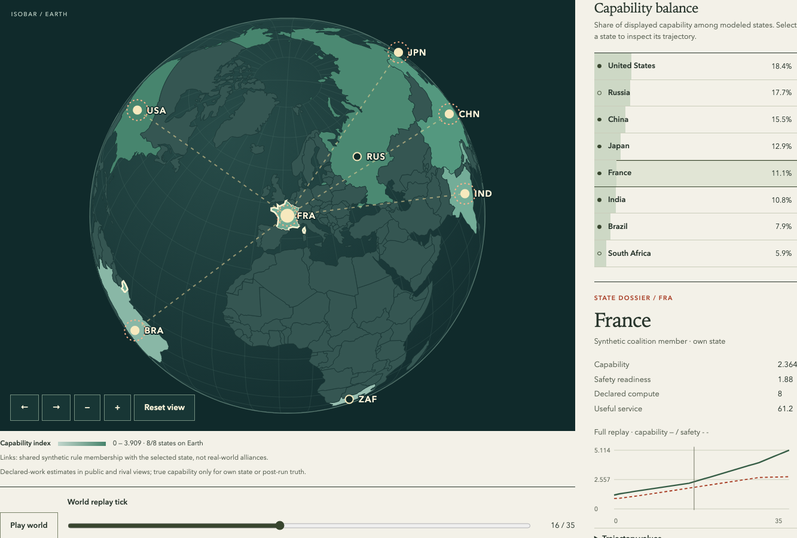
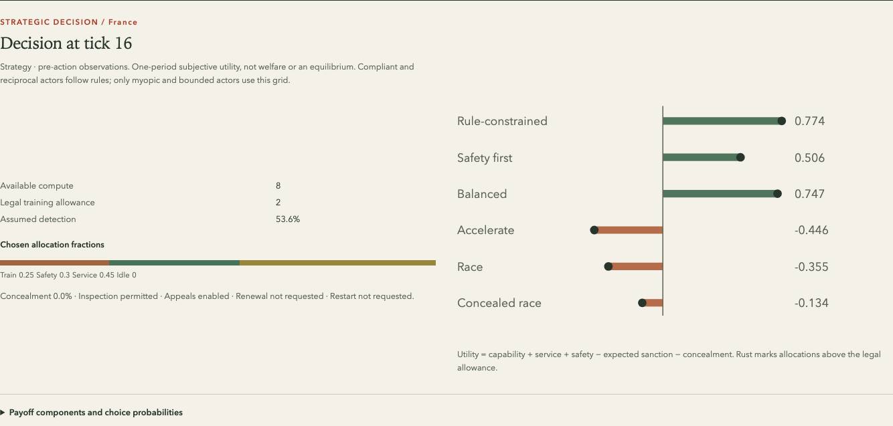

<div align="center">

# Isobar

**An inspectable simulation laboratory for AI governance.**

Explore how competition, imperfect information and institutional power shape an AI development race.

[](https://github.com/AbdelStark/isobar/actions/workflows/check.yml)
[](LICENSE)
[](pyproject.toml)

[Quickstart](#quickstart) · [Explore the world](docs/earth-explorer.md) · [Model card](docs/model-card.md) · [Research foundations](docs/research-foundations.md) · [Contribute](CONTRIBUTING.md)

</div>



*Actual workbench, `world` scenario, seed 42, tick 16, France's observations. Country names and geography are real; all national parameters, preferences and coalition assignments are synthetic.*

An agreement can reduce risky development while restricting useful work. A monitor can detect a breach or generate a false allegation. An institution can enforce a rule while becoming difficult to hold accountable. Isobar makes these mechanisms explicit, so you can change an assumption, replay the consequences and inspect who knew what when they acted.

It combines an agent-based Python simulator with an interactive Earth workbench. Every decision, report, sanction and appeal belongs to a reproducible trace. Outcomes stay separate: incidents, service, access, privacy, cooperation and concentrations of compute and authority.

> **Research scope:** Isobar explores conditional mechanisms. Its fixtures are uncalibrated, its actors aggregate jurisdictions and developers, and its outputs do not establish national forecasts or policy effectiveness. [Assumptions and limits →](docs/model-card.md)

## Quickstart

Requires **Python 3.12**, **Node 24**, [`uv`](https://docs.astral.sh/uv/getting-started/installation/) and `make`. No GPU, model weights or API keys are required.

```sh
git clone https://github.com/AbdelStark/isobar.git
cd isobar
make setup
make serve
```

Open **http://127.0.0.1:4318**. Setup downloads locked dependencies; the running workbench uses bundled geography and makes no external requests.

1. Select **Simulate world**, choose a nation and play the timeline.
2. Switch between capability, readiness and service layers. Inspect coalition membership or a nation's perceived rival deviation.
3. Select **See this nation's observations**, then **Inspect this decision** to examine its incentives and chosen allocation.
4. Select **Change its decision** to create a counterfactual branch. Compare policies across matched seeds in the workbench below.

The server is designed for trusted local use. [Deployment and export boundaries](SECURITY.md) matter even when the source is public.

## What you can investigate

| Question | Mechanisms you can inspect |
|---|---|
| When does reciprocal restraint unravel? | Hidden capacity, delayed reports, belief updates, retaliation thresholds and forgiveness. |
| What changes when monitoring improves? | Coverage, sensitivity, false positives, shared monitor failures, inspection costs and privacy exposure. |
| What survives a development freeze? | Existing capability, service, external diffusion, non-members and residual misuse. |
| Can an institution correct its own mistakes? | Allegations, findings, paid enforcement, independent appeals, restoration and budget exhaustion. |
| Who gains, and who bears the cost? | Per-group service, access denial, exposure and incidents; separate compute and authority concentration. |

The catalog includes **seven scenarios**, **four policy families**, **four strategy rules** and **three hazard families**. The Earth fixture models eight jurisdictions. Six smaller fictional fixtures isolate racing, hidden capacity, freeze residuals, false allegations, leakage and institutional capture. [Browse the fixtures](src/isobar/scenarios.py).

## The model, in brief

Each actor divides its available compute among training, safety, service and idle capacity. Concealment and institutional choices are explicit actions. Policy changes obligations and enforcement; it does not make a physically feasible violation disappear.

Every tick processes due evidence and institutional changes, freezes each actor's observations, chooses all actions, then applies work and hazards. Public estimates, an actor's own information and post-run ground truth remain distinct.

| Strategy | Decision rule |
|---|---|
| `compliant` | Stay within the training allowance; allocate remaining effort to safety and service. |
| `reciprocal` | Maintain restraint until the largest perceived rival-deviation probability crosses a threshold. |
| `myopic` | Choose the highest one-period subjective utility from six candidate allocations. |
| `bounded` | Sample that grid using a logit response: $P(a \mid o_i) \propto \exp(\lambda_i U_i(a; o_i))$. |

Here, $o_i$ is the actor's pre-decision observation; $U_i$ combines capability, service and safety benefits with expected sanction and concealment costs. The configured `temperature` is the **inverse** temperature $\lambda_i$: zero gives uniform choice over grid entries. The decision inspector calls the [same payoff code](src/isobar/strategies.py) used by the strategies.

These are explicit behavioral rules. The dynamic simulator does not solve for a Nash, perfect Bayesian or quantal-response equilibrium. Exact transitions, evidence likelihoods, scheduling and metric denominators are in the [model card](docs/model-card.md).

<details>
<summary>See a recorded decision and its payoff decomposition</summary>



The same `world` run, seed 42. France follows the compliant rule; the utility chart exposes alternative allocations without implying that this actor optimizes over them.

</details>

## Game theory and institutional foundations

The connection to each source has a specific scope. Mathematical reproduction, behavioral analogy and institutional motivation are different kinds of evidence.

| Foundation | Relationship to Isobar |
|---|---|
| **AI race incentives** — [Armstrong, Bostrom & Shulman (2013)](https://nickbostrom.com/papers/racing-to-the-precipice.pdf) | A separate analytic module implements the reduced game's no/private/public-information formulas, checked against hand cases and numerical integration. It does not validate the dynamic simulator. |
| **Repeated cooperation** — [Axelrod & Hamilton (1981)](https://public.websites.umich.edu/~axe/research/Axelrod%20and%20Hamilton%20EC%201981.pdf) | Reciprocity motivates a question to investigate. Isobar's threshold-and-belief rule is its own specification; it does not reproduce the iterated prisoner's-dilemma tournament. |
| **Probabilistic choice** — [McKelvey & Palfrey (1995)](https://authors.library.caltech.edu/records/4fh4n-4c340) | The bounded strategy uses logit choice. There is no joint fixed-point calculation, so this is not a quantal-response equilibrium implementation. |
| **Institutional analysis** — [Ostrom (2009)](https://www.nobelprize.org/uploads/2018/06/ostrom_lecture.pdf) | Monitoring, sanctions and conflict resolution motivate separate institutional mechanisms. The current model has one institution, without polycentric governance, endogenous rule bargaining or graduated sanctions. |

[Research foundations](docs/research-foundations.md) maps these connections to code, tests and open questions, and explains how the documentation relates to the [ODD modeling protocol](https://www.jasss.org/23/2/7.html).

## For ML and agent research

Isobar provides typed scenarios and actions, observation filtering, classical baselines, recorded policy decisions and matched-seed comparisons. These are useful building blocks for controlled experiments on decision behavior under partial information.

The current implementation runs on the CPU using Python and Pydantic. Learned policies, hosted inference, an online agent runner and Gymnasium/PettingZoo adapters are not included. An external model can supply **recorded structured actions** through the same validation path as a human intervention; the kernel does not execute supplied code.

```python
from isobar.engine import branch, project, simulate
from isobar.scenarios import get_scenario

scenario = get_scenario("world")
original = simulate(scenario)
observed = project(original, "fra")  # France's own state and observed rivals

alternative = branch(
    original,
    tick=3,
    actor_id="fra",
    action={"train": 0.0, "safety": 0.5, "service": 0.5, "idle": 0.0},
)
assert alternative["frames"][:3] == original["frames"][:3]
```

For externally generated decisions, pass `actions={"3:fra": action_dict}` to `simulate`, or use `isobar run --actions actions.json`. Missing overrides use the configured strategy; malformed supplied actions produce a recorded idle fallback. [Action contract and offline workflows →](docs/user-guide.md#replay-and-intervene-offline)

## Reproducible experiments

Run, verify and compare without opening a browser:

```sh
uv run isobar run world -o runs/world.json
uv run isobar replay runs/world.json --view public
uv run isobar compare s2 --seeds 1 2 3 4 5 6 7 8 -o runs/reciprocity.json
```

The comparison writes per-policy summaries, paired differences, per-group outcomes and the underlying runs. Its 95% normal-approximation intervals describe Monte Carlo variability **within the chosen model**; they exclude parameter and structural uncertainty. Small samples can give poor coverage.

- **Keyed randomness:** separate streams for processes and actors keep unrelated draws stable across interventions. A shared seed pairs exogenous draws, not necessarily realized events.
- **Verified replay:** artifacts are checked by deterministic re-execution, including nested branch history. Output files are not overwritten.
- **Explicit provenance:** scenarios carry units, assumptions and evidence labels; bundles record input, model and runtime identity. Cross-platform bit-identical floating-point output is not promised.
- **Multiple outcomes:** no scalar leaderboard trades service, rights-related proxies and incidents against each other. An undefined denominator stays `null`.

Research bundles contain hidden state regardless of the displayed view. Private scenario classification blocks public-classification export. Read the [local trust boundary](SECURITY.md) before sharing artifacts.

## Verification

```sh
make browser-setup  # install Chromium once
make verify         # kernel, frontend, real-browser and isolated-package checks
```

Stop your development server before browser tests; the suite owns port 4318. Smaller gates are `make check`, `make check-browser` and `make check-package`.

The [acceptance record](docs/acceptance.md) maps requirements to concrete tests: deterministic replay, actor-order invariance, observation isolation, all 16 policy/strategy combinations, correlated monitor failure, false allegations, appeals, nested interventions, terminal-run accounting, and real desktop/mobile workflows. The package gate installs a fresh wheel outside the checkout and exercises its CLI and HTTP interfaces.

The [separate analytic check](docs/analytic-baseline.md) is reproducible with:

```sh
uv run pytest tests/test_baselines.py -q
```

Passing software tests establishes implementation behavior. Empirical calibration, independent methods review and human usability research remain open work.

## Documentation and contributions

| Start here | What it contains |
|---|---|
| [Earth explorer](docs/earth-explorer.md) | Globe controls, nation dossiers, decision inspection and map provenance. |
| [User guide](docs/user-guide.md) | Scenario authoring, actions, exports, cancellation and resumption. |
| [Model card](docs/model-card.md) | Entities, equations, assumptions, scheduling and units. |
| [Research foundations](docs/research-foundations.md) | Theory-to-implementation mapping and experimental discipline. |
| [Python and HTTP contract](docs/mvp-contract.md) | Validated inputs, outputs and integration boundaries. |
| [Contributing](CONTRIBUTING.md) | Development setup, model-change requirements and verification gates. |

[Issues](https://github.com/AbdelStark/isobar/issues) are welcome for reproducible bugs, unclear assumptions and proposed experiments. Particularly useful contributions include sensitivity analyses, independently checked mechanisms, observation-boundary tests and teaching scenarios with clear provenance. A model change should include an assumption, a falsifiable implementation claim and a reproducer.

The reference model aggregates each jurisdiction and developer into one actor and each jurisdiction's population into one group. It has no calibrated geopolitics, strategic firms, trade, military conflict or general theory of human behavior. Geography is presentation context. AI-assisted implementation and documentation are disclosed; review the code and evidence for the claim you intend to make.

## License and citation

[MIT](LICENSE). Bundled geography and dependencies retain their [third-party notices](web/public/third-party.txt).

When using Isobar in research, cite the repository **and the exact commit**, and preserve the scenario, seed set, overrides, observation boundary and exported artifacts. The references above credit the underlying literature; they are not endorsements of this implementation.

```bibtex
@software{isobar,
  author = {{Isobar contributors}},
  title = {Isobar: An Inspectable Simulation Laboratory for AI Governance},
  year = {2026},
  url = {https://github.com/AbdelStark/isobar},
  note = {Specify the commit and scenario configuration used}
}
```
